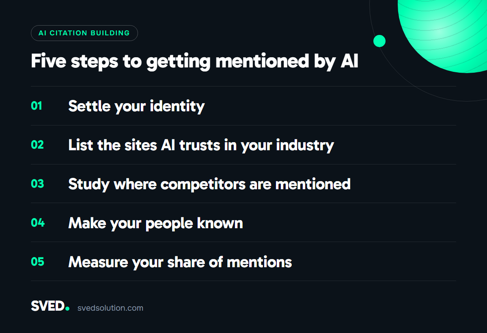

ChatGPT, Perplexity and Gemini do not name you because of your homepage. It happens **off your own domain**. **AI citation building** is the work of getting your brand described the same way on independent sites that AI tools trust, so your brand is the one they name. (An AI citation is when an AI answer uses your brand or site as a source.) If you have searched for an **AI citation building service** or an **AI citation audit**, here is exactly what it is and how to start.

## Why AI citations happen off your own site

When an AI tool answers a question, it starts by recalling which brands it links with the topic. Then it looks for sources that support naming them. Your homepage and a competitor's homepage are never weighed against each other. That memory is built from repeated, matching mentions across the outside sites the AI tool already trusts. A brand described the same way on a review platform, a data aggregator, a community thread and a few industry publications looks like agreement between independent sites. A brand that only describes itself, on its own site, has no such agreement.

This is why work on your own pages stops paying off after a point. It is also why [AI citation and entity building](/services/ai-citation-entity-building/) is often the activity with the biggest return in AI search.

## What an AI citation audit uncovers

The work starts with an audit, a review of where you stand today, so nothing is left to guesswork:

- **Which questions** your buyers really ask AI, and **which brands** get named for them.
- **Which sources** the AI tools name alongside those brands. This is your real target list.
- **Where your identity is unclear**: names, descriptions or categories that differ from place to place and confuse the AI tool.
- **Your current share of AI mentions** compared with named competitors, as a starting point to measure against.

## Citations vs backlinks: not the same job

| | Backlink | AI citation |
|---|---|---|
| Passes | Ranking strength to a page | Recognition to a brand |
| Judged by | Domain rating (the strength of the linking site) | How relevant and consistent the mention is |
| Wins | A higher Google position | A mention inside the AI answer |

Ten relevant, consistent mentions in sources an AI tool already reads do more for AI visibility than a hundred links from strong but unrelated sites. They do different jobs and need different work.

## How to build AI citations

<figure style="margin:1.5rem 0"><figcaption style="font-size:.85rem;color:var(--text-faint);margin-top:.7rem;text-align:center">AI citation building, in five steps.</figcaption></figure>

1. **Settle your identity.** One official brand name, description and category, shown in exactly the same way on your site, your profiles and your `Organization` schema (code that tells machines who you are).
2. **List the outside sites AI trusts in your industry.** The right sources differ by industry: review databases, credentialed directories, marketplaces, trade press. We work out yours from what AI tools really name in your niche. A generic list will not do.
3. **Study competitor mentions.** Take the brands already named in AI answers and go after the same sources with better material.
4. **Make your people known.** Founders and experts that AI tools can recognise, with consistent bios, bylines and credentials.
5. **Measure your share of mentions.** Track how often your brand is named, using a fixed set of questions on a fixed schedule. This is [AI visibility monitoring](/services/ai-visibility-monitoring/).

The timeline is honest. AI tools register who you are at 30 to 45 days. First mentions come around day 60, and consistent mentions by day 90. No one controls these AI tools, so anyone who guarantees a mention is guessing. The inputs, though, are fully within your control. For the wider picture, see [what is GEO](/insights/what-is-generative-engine-optimization/).

## Frequently asked questions

**What is an AI citation building service?**
A service that builds the consistent presence on outside sites that AI tools read as authority. It covers a clear brand identity, a list of trusted sites for your industry, a study of competitor mentions, and tracking, so your brand is named by AI.

**What is an AI citation audit?**
A review that maps which questions your buyers ask, which brands and sources AI names for them, where your identity is unclear, and your current share of mentions compared with competitors.

**Why does off-site matter more than my website?**
AI tools trust independent confirmation more than what you say about yourself. Consistent mentions on outside sites send a signal that nothing on your own domain can.

**Is a citation the same as a backlink?**
No. A backlink passes ranking strength. A citation passes brand recognition. For AI visibility, relevance and consistency beat raw site strength.

**How long until we get cited?**
AI tools register who you are at 30 to 45 days. First mentions come around day 60, consistent mentions by day 90, and lasting authority at 9 to 12 months.

## The bottom line

AI citation building is how brands go from unseen to named in AI answers. It happens off your own site, through a consistent identity and backing from independent sites. Start with an [AI citation and entity building project](/services/ai-citation-entity-building/) or run a free AI visibility check. It runs 20 checks on your live URL and needs no card.
