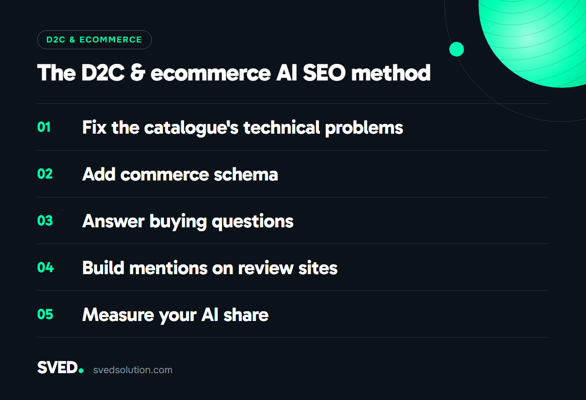

More and more shoppers start with a question to ChatGPT or Google's AI Overview (the AI summary above the results), such as "what's the best [product] for [need]?". Then they buy from the brands it names. For a D2C or ecommerce brand, **AI SEO** now decides whether you are on that shortlist or left out. This guide shows how to get your products found on Google **and** recommended by AI.

## Why AI SEO is different for ecommerce and D2C

1. **Shoppers decide earlier.** Buyers ask AI for recommendations before they visit a store or a marketplace. If your brand is not named, the sale is often decided before the shopper ever reaches you.
2. **Trust signals decide the outcome.** AI tools lean on reviews, ratings and steady mentions on other sites. A D2C brand competing with marketplaces has to build these on purpose.
3. **A large catalogue is a technical challenge.** Filter pages, product variants and thin category pages make your site hard for Google and AI tools to read. That quietly limits how often you are seen.

That is the focus of our [ecommerce and D2C SEO](/ecommerce-d2c-seo/) work.

## What our AI SEO for D2C & ecommerce covers

| What you get | The service | Outcome |
|---|---|---|
| Get named by ChatGPT, Perplexity & AI Overviews | [Answer Engine Optimization](/services/answer-engine-optimization/) + [AI citation building](/services/ai-citation-entity-building/) | Your brand is recommended, not just listed |
| Rank product & category pages | [Technical SEO](/services/technical-seo/) + Product/Review schema | Shoppers who are ready to buy |
| Buying guides AI quotes | [Content strategy](/services/content-strategy/) | Early interest that turns into sales |
| A brand AI trusts | Mentions on review sites | Independent backing, which AI rewards |

## The shift: shoppers ask AI what to buy

Ask an AI tool for the best running shoe, skincare routine or coffee maker. It names a handful of brands and points to a handful of sources: reviews, guides and marketplaces. You become one of the named brands through Product and Review schema (code that labels your price, stock and ratings for machines), comparison content that answers the question directly, and consistent mentions across trusted review platforms. When an AI answer uses your site as a source, that is called an AI citation. All of this is [Generative Engine Optimization](/generative-engine-optimization/), or GEO, applied to retail. For how it works in detail, see [how to appear in Google AI Overviews](/insights/how-to-appear-in-google-ai-overviews/).

## The D2C & ecommerce AI SEO method

<figure style="margin:1.5rem 0"><figcaption style="font-size:.85rem;color:var(--text-faint);margin-top:.7rem;text-align:center">The D2C & ecommerce AI SEO playbook.</figcaption></figure>

1. **Fix the catalogue's technical problems.** Control filter pages and product variants. Remove low-value pages from Google's index. Make product content load fast and arrive ready in the page's HTML (server-rendered).
2. **Add commerce schema.** `Product`, `Offer`, `Review` and `FAQPage` markup, so Google and AI tools understand your price, availability and rating.
3. **Answer buying questions.** Write comparison pages and buying guides that open with a direct answer. That is the format AI tools quote.
4. **Build mentions on review sites.** Be present, and described the same way, across the review platforms and marketplaces AI tools trust.
5. **Measure your AI share.** Track how often AI names your brand for the questions shoppers ask about your category, on a fixed routine.

## Frequently asked questions

**What is AI SEO for ecommerce?**
It means setting up product and category pages for Google and AI tools. The work covers technical SEO, commerce schema, buying guides and mentions on trusted sites, so shoppers find your products and AI recommends your brand.

**How do D2C brands get recommended by ChatGPT?**
Through steady reviews and mentions on other sites, Product/Review schema, and comparison content that answers the question directly. For purchases, AI tools give a lot of weight to what independent sites say.

**Is AI SEO worth it for a small D2C brand?**
Yes. Being named by AI for even a few buying questions in your category can bring in shoppers who are ready to buy. Unlike paid ads, the work keeps building on itself.

**Does this work for brands in India?**
Yes. AI use is growing fast in India, so shoppers here turn to AI recommendations early. Brands that start now get the head start.

**How long before results show?**
Product and category pages typically improve in 60–90 days. AI mentions follow the usual pattern: your brand is recognised by AI tools at 30–45 days, and first mentions come around day 60.

## The bottom line

For D2C and ecommerce, AI SEO means being present in the places where shoppers now decide: Google *and* AI answers. Fix the catalogue, add commerce schema, answer buying questions, and build mentions on review sites. [Explore our ecommerce and D2C SEO](/ecommerce-d2c-seo/) or run a free AI visibility check: 20 checks on your live URL, no card required.
