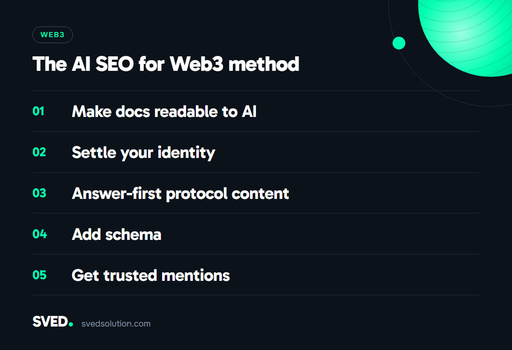

Crypto users now do their research inside AI tools. Before they bridge funds or connect a wallet, they ask ChatGPT or Perplexity "which protocol is safe for this?" Then they act on the projects it names. **AI SEO for Web3** is how your project becomes one of those names. It is a different job from ranking on Google, and this guide explains how it works. (For an overview of our agency work, see our [Web3 & crypto SEO agency](/insights/web3-crypto-seo-agency/) guide.)

## What "AI SEO for Web3" actually means

Traditional SEO ranks your page in a list. AI SEO makes your project the brand an AI tool names inside its answer. For Web3 that change is sharper than in most niches, because crypto is a high-risk category. AI tools are careful and look for backing from other sites before they will recommend a protocol, chain or dApp. So the work is less about keywords and more about being a **project AI can find, described the same way everywhere and backed by other sites**. That is the heart of our [Web3, crypto and blockchain SEO](/web3-crypto-seo/) work.

## Why Web3 projects are invisible to AI (and how to fix it)

Three problems show up on almost every crypto site:

1. **JavaScript-only sites.** Most dApp frontends and docs are built in the visitor's browser, so AI crawlers see an empty shell. Render the content that matters on the server instead.
2. **A split identity.** The project is described three different ways across the site, explorer, GitHub, listings and socials. The AI tool cannot tell that these are one project it can trust.
3. **No presence on trusted sources.** Nothing on your own domain gives AI tools the outside backing they need. It has to come from the crypto sources they already trust.

Fixing these takes [LLM SEO](/services/llm-seo/) (making your site readable to AI models) plus [AI citation and entity building](/services/ai-citation-entity-building/) (getting mentioned on the sites AI trusts).

## The AI SEO for Web3 method

<figure style="margin:1.5rem 0"><figcaption style="font-size:.85rem;color:var(--text-faint);margin-top:.7rem;text-align:center">The AI SEO for Web3 method.</figcaption></figure>

| Step | What to do | Why it matters |
|---|---|---|
| Make docs readable to AI | Server-render docs and dApp content | AI crawlers read raw HTML, not JS |
| Settle your identity | One name, description and category everywhere | AI tools name projects they can confirm |
| Answer-first protocol content | Direct answers on fees, security, staking, tokenomics | These are the passages AI lifts |
| Add schema | Organization, FAQPage, sameAs to socials/explorers | Trust signals machines can read |
| Get trusted mentions | Aggregators, directories, reputable crypto press | The outside backing that gets you named |

## How users actually find you now

Ask an AI tool to recommend a wallet, L2, launchpad or DeFi protocol. It names a few and lists a few sources, usually data aggregators, docs and reputable coverage. Projects get named because they are consistent and backed by other sites. Clever copy does not do it. That is [Generative Engine Optimization](/generative-engine-optimization/) (GEO, the work of getting named in AI answers) applied to Web3. See [how to rank in ChatGPT](/insights/how-to-rank-in-chatgpt/) for how AI tools look pages up and remember brands.

## Frequently asked questions

**What is AI SEO for Web3?**
It is the work of making a blockchain or crypto project easy for AI tools to find, trust and name. It uses technical SEO, one clear identity, answer-first content and mentions on trusted sources.

**How is it different from normal crypto SEO?**
Normal SEO ranks a page. AI SEO gets your project named inside an AI answer. Because crypto is high-risk, AI tools look even harder for consistency and backing from other sites.

**Why doesn't my dApp show up in ChatGPT?**
Usually because the content is JavaScript-only (crawlers cannot see it), your project is described in different ways, or you have no presence on trusted sources. Those three are the things to fix.

**Do AI engines really recommend crypto projects?**
Yes, with care. They name projects they can confirm across trusted sources. That is exactly why planned work to earn mentions matters in Web3.

**How long until we get cited?**
AI tools typically register who you are at 30 to 45 days. First mentions come around day 60, and consistent mentions by day 90.

## The bottom line

AI SEO for Web3 comes down to trust and being found. Make your project readable, settle its identity, answer the real questions, and earn backing across trusted crypto sources. Do that and your protocol has a real chance of being the one AI names. [Explore our Web3, crypto and blockchain SEO](/web3-crypto-seo/) or run a free AI visibility check. It runs 20 checks on your live URL and needs no card.
