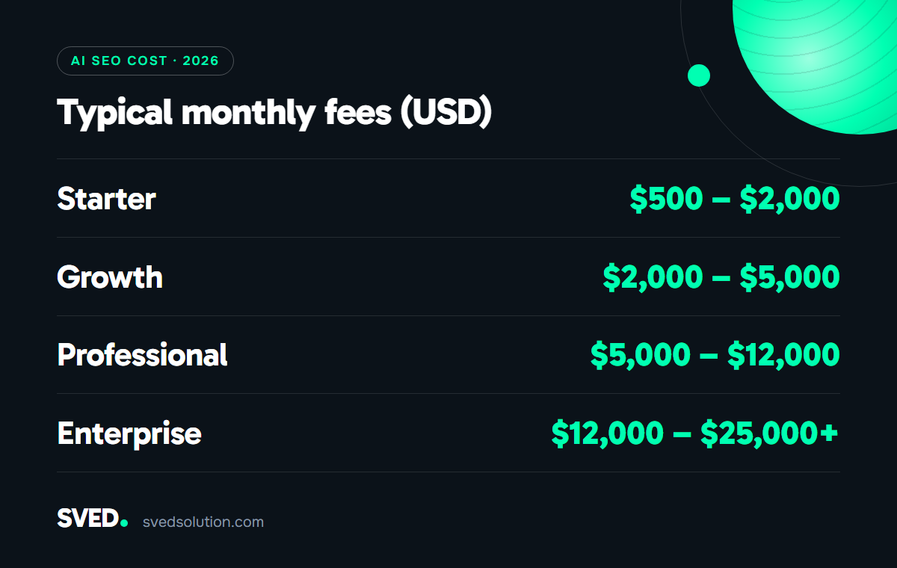

Search has split in two. Buyers now ask ChatGPT, Google AI Overviews, Gemini and Perplexity before they ever reach a checkout. AI Overviews (Google's AI-written summaries) appeared on roughly **48% of tracked queries by early 2026, up from about 31% a year earlier, while click-throughs fell nearly 30%** (BrightEdge tracking). That change put a new line on every marketing budget: AI SEO. And the first question every business asks is simple: **what does AI SEO actually cost in 2026?**

This guide sets out real 2026 prices for monthly fees, hourly rates and one-off projects, compared across **USD, GBP, EUR and INR**. It also covers what you get at each level, what pushes the price up or down, and how to avoid overpaying.

## What AI SEO pricing looks like in 2026

AI SEO is priced as a **service, not a software subscription**. An agency gives you a team that combines traditional SEO with Generative Engine Optimization (GEO, getting your brand named in AI answers) and Answer Engine Optimization (AEO, making your page the direct answer to a question). It also tracks how often you are mentioned across Google AI Overviews, ChatGPT, Perplexity, Gemini and Claude. Three ways to pay are most common:

- **Monthly retainer.** The most common: a fixed monthly fee for ongoing improvements, content and technical work.
- **Project-based.** A fixed fee for one defined piece of work (a site review, a schema rebuild, a set of linked articles). Typically $1,500–$50,000 depending on size.
- **Performance-based.** A base monthly fee plus bonuses tied to rankings or AI mentions. Less common, growing slowly.

AI SEO adds three things on top of classic SEO: structured data (code that labels your content for machines), work on how clearly AI tools know who you are, and tracking across several AI tools. So it costs roughly **20–40% more than traditional SEO**. The extra work is real. It is no rebrand.

## AI SEO cost by tier (USD, GBP, EUR, INR)

<figure style="margin:1.5rem 0"><figcaption style="font-size:.85rem;color:var(--text-faint);margin-top:.7rem;text-align:center">Typical 2026 AI SEO monthly retainers (USD).</figcaption></figure>

Monthly fees, converted at approximate mid-2026 rates (£0.79, €0.92, ₹88 per $1). Exchange rates move, so treat these as a guide:

| Tier | USD / mo | GBP / mo | EUR / mo | INR / mo |
|---|---|---|---|---|
| **Starter / foundational** | $500–$2,000 | £400–£1,600 | €460–€1,850 | ₹44,000–₹1.75L |
| **Growth** | $2,000–$5,000 | £1,600–£3,950 | €1,850–€4,600 | ₹1.75L–₹4.4L |
| **Professional** | $5,000–$12,000 | £3,950–£9,500 | €4,600–€11,000 | ₹4.4L–₹10.5L |
| **Enterprise** | $12,000–$25,000+ | £9,500–£19,750+ | €11,000–€23,000+ | ₹10.5L–₹22L+ |

The wide ranges mostly come down to **region and competition**. A starter package delivered from a lower-cost country can sit near the bottom of a tier. A US enterprise program in a field where Google is extra careful, such as health or money, sits at the top.

## Hourly rates by region

For reviews, consulting and one-off fixes, AI SEO is often billed by the hour. The gap between regions is the reason so much work is delivered from overseas:

| Region | Hourly (local) | Hourly (USD) |
|---|---|---|
| India | ₹1,750–₹5,300 | $20–$60 |
| United Kingdom | £55–£140 | $70–$180 |
| Europe (EU) | €60–€155 | $65–$170 |
| United States | $100–$250+ | $100–$250+ |

Indian specialists typically cost **50–70% below the equivalent US rate** without a matching drop in quality. That is why global brands send the hands-on work there.

## Project-based (one-off) pricing

| Piece of work | Typical cost (USD) |
|---|---|
| AI SEO / GEO visibility audit (site review) | $1,500–$7,500 |
| Brand identity & schema (structured data) setup | $3,000–$15,000 |
| Content cluster (a set of linked articles) | $5,000–$25,000 |
| Full technical + structured-data rebuild | $5,000–$50,000 |

## What you actually get at each price point

- **Starter ($500–$2,000):** AI Overview work on 10–20 keywords, basic technical SEO, basic schema markup, 2–4 pieces of content a month, and a first GEO review.
- **Growth ($2,000–$5,000):** a full AEO/GEO plan, 8–12 pieces of content, work on how clearly AI tools know your brand, tracking of AI mentions, and ongoing technical fixes.
- **Professional ($5,000–$12,000):** the depth a competitive field needs, more content each month, work across several AI tools, and a dedicated strategy.
- **Enterprise ($12,000–$25,000+):** programs for several locations or markets, 20+ pieces of content, custom tracking of AI answers, and a dedicated strategist.

## What drives the number up or down

1. **Industry.** SaaS, fintech and healthcare are crowded fields. They also touch health and money, where Google is extra careful. Expect **30–50% more**.
2. **Number of AI platforms.** Working on Google AI Overviews alone costs less than covering ChatGPT, Perplexity, Gemini and Claude together.
3. **Content speed.** Producing content fast to catch new searches costs extra.
4. **Technical complexity.** An old website system, a poor site structure or missing structured data means more work at the start.
5. **Region of delivery.** The biggest factor of all. The same work can cost 3–5× more delivered from the US than from India.

## How to evaluate AI SEO costs (don't compare on the monthly fee alone)

Compare on **cost per outcome**. The monthly figure alone says little. An $8,000/month program that produces 12 pieces of content and tracks 100 keywords across AI tools gives you more per dollar than a $5,000 one that produces 4 pieces and tracks 20. Before you sign, ask any agency to name: the exact AI platforms they work on, how much content and what type, the technical work included, how often they report, and their **GEO and AI-citation methodology**. An AI citation is when an AI answer uses your site as a source. Many "AI SEO" offers are traditional SEO with buzzwords. The test is whether they can show clients that actually appear inside ChatGPT or AI Overviews.

## Common budgeting mistakes

- **Treating AI SEO as one-off.** AI models get retrained and competitors move. A single burst of work fades in 60–90 days. Budget for 9–12 months.
- **Buying the cheapest option.** "AI SEO" for under $1,000 is usually basic on-page work with a new label.
- **Cutting budget at month 4.** Results build on each other: foundations in months 1–3, early gains in 4–6, real return in 7–12.
- **Forgetting content costs.** AI tools reward thorough content that makes clear who and what it is about. If content isn't in the quote, budget for it separately.

## Why outsource AI SEO services to SVED Solution

For most businesses, the smartest way to buy AI SEO in 2026 is to **outsource to a specialist that delivers global-standard work at efficient rates**. That is what SVED Solution is built for. We are a 360° SEO and AI-visibility agency, operating since 2018 across ten industries in four countries. We price for results, with no premium for a famous name: **consulting from $30/hour, with monthly work planned only after a first review of your site**. So you never pay for a fix before the problem is understood. You get senior GEO, AEO and technical SEO expertise, delivery from India at a fraction of US or UK agency cost, clear reporting that counts AI mentions as a real number, and an honest timeline with no guaranteed-ranking sales talk. In a market where a US "starter" package begins at $2,000 a month, that mix of specialist depth and lower cost is hard to match.

Our AI SEO services cover: [Generative Engine Optimization](/generative-engine-optimization/), [Answer Engine Optimization](/services/answer-engine-optimization/), [AI citation & entity building](/services/ai-citation-entity-building/), [technical SEO](/services/technical-seo/), [content strategy](/services/content-strategy/), and flexible [SEO consulting](/services/seo-consulting/). New to the subject? Start with [GEO vs SEO](/insights/geo-vs-seo/) and [how to rank in ChatGPT](/insights/how-to-rank-in-chatgpt/).

## Frequently asked questions

**How much do AI SEO services cost in 2026?**
Between roughly $500 and $25,000+ per month, depending on the work, region and competition. Small businesses typically budget $500–$2,000 (₹44,000–₹1.75L, £400–£1,600, €460–€1,850). Mid-size companies budget $2,000–$5,000. Enterprise budgets run $12,000–$25,000+.

**Why is AI SEO more expensive than traditional SEO?**
It adds work traditional SEO never needed: Generative Engine Optimization, identity and schema work so AI language models (LLMs) understand your brand, and tracking of mentions across several AI platforms. That pushes the cost up about 20–40%.

**What is the cheapest way to get AI SEO done well?**
Outsource to a specialist in a lower-cost region. Indian agencies charge 50–70% below US rates for comparable quality. SVED Solution starts consulting at $30/hour, and plans monthly work only after a site review.

**How long before AI SEO shows results?**
First signs in 60–90 days, meaningful results by month 4–6, and returns that keep building at 9–12 months. Anyone promising AI mentions in two weeks is guessing.

**Is AI SEO worth the investment?**
For businesses that rely on being found through unpaid search, usually yes. Brands mentioned inside AI Overviews have been shown to get around 35% more organic clicks than competitors on the same query. And unlike paid ads, that trust keeps working after the bill is paid.

**Hourly consulting or a monthly retainer?**
Hourly suits a one-off review or fix. A monthly retainer is better for ongoing improvements, content and the slow build of trust that AI SEO depends on.

## The bottom line

AI SEO in 2026 ranges from about $500 to $25,000+ a month. The right number depends on the work you need, your industry and where the work is delivered. Compare on cost per outcome, budget for 9–12 months, and pick a partner who can prove real AI mentions. If you want specialist AI-visibility work without US-agency pricing, [see how SVED Solution can help](/contact/) or run a free AI visibility check: 20 checks against your live URL, no card required.
