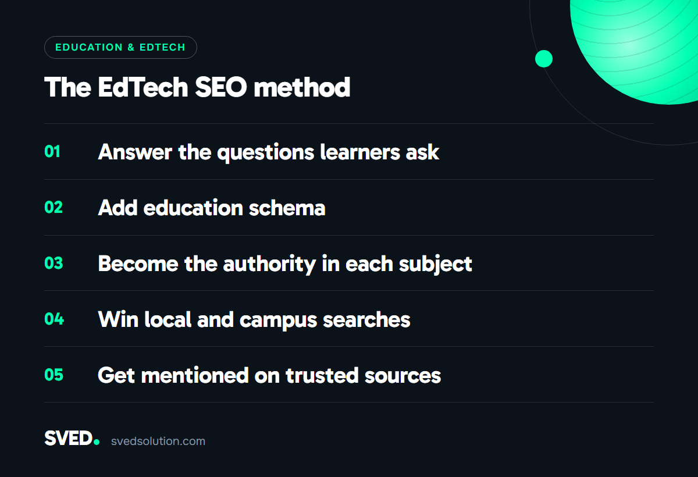

If you searched for an **education SEO company in India** or **EdTech SEO**, you are in a fast-moving market. More Indian learners now ask ChatGPT, Gemini or Google's AI Overview "which course should I take?" before they ever compare providers. India also leads the world in AI adoption, so this change is happening faster here than almost anywhere. SVED Solution helps education brands rank on Google **and** get recommended by AI. Here is our method.

## Why EdTech and education SEO is different

1. **The decision is big and carefully researched.** A degree, bootcamp or certification is a major commitment. Learners compare outcomes, fees and placement over weeks, and more than one person is involved (often a parent).
2. **AI now shapes the shortlist.** Before they download a prospectus, students ask AI for recommendations. If your program is not named, you are off the list before they even start comparing.
3. **Few people search, but those who do are serious.** Exact searches like `education seo company india` have low volume and low competition, while an enrolled student is worth a lot. A serious searcher matters more than a large number of searches.

That is the focus of our [education and EdTech SEO](/education-edtech-seo/) work.

## What our education & EdTech SEO services cover

| What you get | The service | Outcome |
|---|---|---|
| Get named by ChatGPT, Gemini & AI Overviews | [Answer Engine Optimization](/services/answer-engine-optimization/) + [AI citation building](/services/ai-citation-entity-building/) | Your program is the one AI recommends |
| Rank for course, program & career searches | [Content strategy](/services/content-strategy/) | Visitors who are likely to enrol |
| A site AI and Google can trust | [Technical SEO](/services/technical-seo/) + education schema | Pages reach Google faster and show rich results |
| Local + subject authority | [Local SEO](/services/local-seo/) | Visibility for city and campus searches |

## The shift: students ask AI which course to take

Ask an AI tool to recommend a data-science course, an MBA or a coding bootcamp. It names a few providers and lists a few sources. To be one of the named providers, you need content from qualified people that answers first, and consistent mentions across education sites. This is [Generative Engine Optimization](/generative-engine-optimization/) (GEO, the work of getting named in AI answers) applied to EdTech. For how it works, see [how to rank in ChatGPT](/insights/how-to-rank-in-chatgpt/).

## The EdTech SEO method

<figure style="margin:1.5rem 0"><figcaption style="font-size:.85rem;color:var(--text-faint);margin-top:.7rem;text-align:center">The education & EdTech SEO method.</figcaption></figure>

1. **Answer the questions learners really ask.** Course comparisons, fees, eligibility, placement rates, career outcomes. Answer them directly in the first 100 words of each page.
2. **Add education schema.** `Course`, `EducationalOccupationalProgram` and `FAQPage` markup (code that labels what is on a page), so Google and AI understand your programs.
3. **Become the authority in each subject.** Group your content around each field, so you are the recognised authority and not a thin catalogue.
4. **Win local and campus searches.** City-plus-course and near-me searches, with proper local SEO.
5. **Get mentioned on trusted sources.** Be present across the education directories, review platforms and press that AI tools and Google trust.

## Frequently asked questions

**What does an education SEO company in India do?**
It helps courses, universities and EdTech platforms rank on Google and appear in AI answers. The work covers program content, education schema, local and subject authority, and mentions on trusted sites, so learners find and trust the institution.

**How do courses get recommended by ChatGPT or AI Overviews?**
Through program content from qualified people that answers first, `Course`/`EducationalOccupationalProgram` schema, and consistent mentions across trusted education sites.

**Is SEO worth it for an EdTech brand with niche keywords?**
Yes. Few sites compete for the exact terms, so they are cheap to win, and one enrolled student is worth a lot over time. A serious searcher who trusts you matters more than volume.

**Why does India move faster on AI search?**
India leads the world in AI adoption and ChatGPT use, so learners here turn to AI recommendations earlier. The brands that do this work now get the head start.

**How long before results show?**
Course and local pages typically move in 60 to 90 days. AI mentions follow the usual timeline: AI tools register who you are at 30 to 45 days, with first mentions around day 60.

## The bottom line

Education and EdTech SEO in India is about being visible where learners now decide: Google *and* AI answers. Answer their real questions, add education schema, build local and subject authority, and get mentioned on trusted sites. [Explore our education and EdTech SEO](/education-edtech-seo/) or run a free AI visibility check. It runs 20 checks on your live URL and needs no card.
