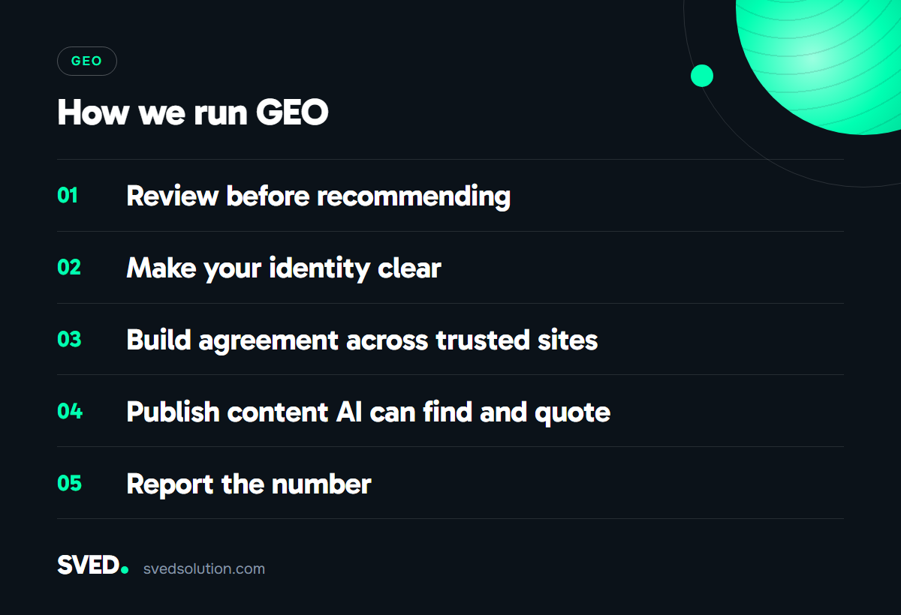

If you searched for a **generative engine optimization agency in India**, you want two things: real GEO expertise and efficient rates. SVED Solution offers both. We get brands named by ChatGPT, Perplexity, Gemini and Google AI Overviews (Google's AI summaries), from India, at a fraction of US or UK agency pricing. Here is what GEO is, why India is a smart base for it, and how we work.

## What a GEO agency actually does

[Generative Engine Optimization](/generative-engine-optimization/) is the work of making a brand easy for AI tools to find, trust and quote. These tools write answers instead of listing links. There is no position one in an AI answer, only which brands get named. A GEO agency builds that through four things: a clear brand identity, agreement about you across independent sites, content AI tools can find and quote, and regular updates. For the full model, see [what is GEO](/insights/what-is-generative-engine-optimization/) and [GEO vs SEO](/insights/geo-vs-seo/).

## Why India is a strong base for GEO

1. **The fastest-moving AI market.** India leads global AI adoption, so the move to finding things through AI answers shows up here first. The expertise has been tested in a market that has already changed.
2. **Global quality, efficient rates.** Indian specialists deliver enterprise-grade GEO at 50–70% below equivalent US rates. That is why global brands have the work done here.
3. **Experience across many markets.** Agencies here routinely serve the US, UK, UAE and India, so GEO is built for a global audience and not for one country.

## What our GEO services include

| What you get | The service | Outcome |
|---|---|---|
| Get named by ChatGPT, Perplexity & Gemini | [AI citation & entity building](/services/ai-citation-entity-building/) | Your brand is the one AI recommends |
| Own the direct answer | [Answer Engine Optimization](/services/answer-engine-optimization/) | Answer boxes, People Also Ask (PAA) and AI Overviews |
| A site AI can read | [LLM SEO](/services/llm-seo/) + [technical SEO](/services/technical-seo/) | Pages AI tools can find and quote |
| Measured AI visibility | [AI visibility monitoring](/services/ai-visibility-monitoring/) | AI mentions reported as a number |

## How we run GEO

<figure style="margin:1.5rem 0"><figcaption style="font-size:.85rem;color:var(--text-faint);margin-top:.7rem;text-align:center">How we run GEO.</figcaption></figure>

1. **Review before recommending.** No monthly fee is quoted before a review. We map which questions your buyers ask AI and which brands it names.
2. **Make your identity clear.** One consistent brand identity across your site, profiles and schema markup (code that labels your details for machines).
3. **Build agreement across trusted sites.** Mentions on the sites AI tools trust in your industry, plus a breakdown of where your competitors get mentioned.
4. **Publish content AI can find and quote.** Pages that give the answer first, with clear structure and schema markup.
5. **Report the number.** AI citations (each time an AI answer uses your site as a source) tracked monthly on a fixed set of questions, and never a rankings report with an AI label on it.

The timeline is honest: your brand is recognised by AI tools at 30–45 days, first mentions come around day 60, consistent mentions by day 90, and lasting authority at 9–12 months. No one can guarantee a mention. Anyone who does is guessing.

## Frequently asked questions

**What does a generative engine optimization agency in India do?**
It gets your brand named inside AI answers through a clear brand identity, mentions on trusted sites, AEO and technical work, delivered from India at efficient rates.

**Is GEO from India as good as a US agency?**
Yes, and often better value. Indian specialists use the same methods at 50–70% lower cost, and India's early AI adoption keeps the expertise up to date.

**How much does GEO cost?**
It depends on how much work is needed. SVED Solution prices for outcomes: consulting from $30/hour, with monthly work planned after a diagnostic review.

**How is GEO different from SEO?**
SEO ranks a page in a list. GEO gets your brand named inside an AI answer, which depends on a clear identity and mentions on other sites. You run both.

**How do you measure GEO?**
How often AI mentions you and your share of mentions against competitors, tested on a fixed set of questions at regular intervals across ChatGPT, Perplexity and Gemini.

## The bottom line

A GEO agency in India gives you AI visibility of a global standard at efficient rates, just as the market moves to finding things through AI answers. Build a clear identity, earn mentions, and get named by AI. [Explore our GEO services](/generative-engine-optimization/) or run a free AI visibility check: 20 checks on your live URL, no card required.
