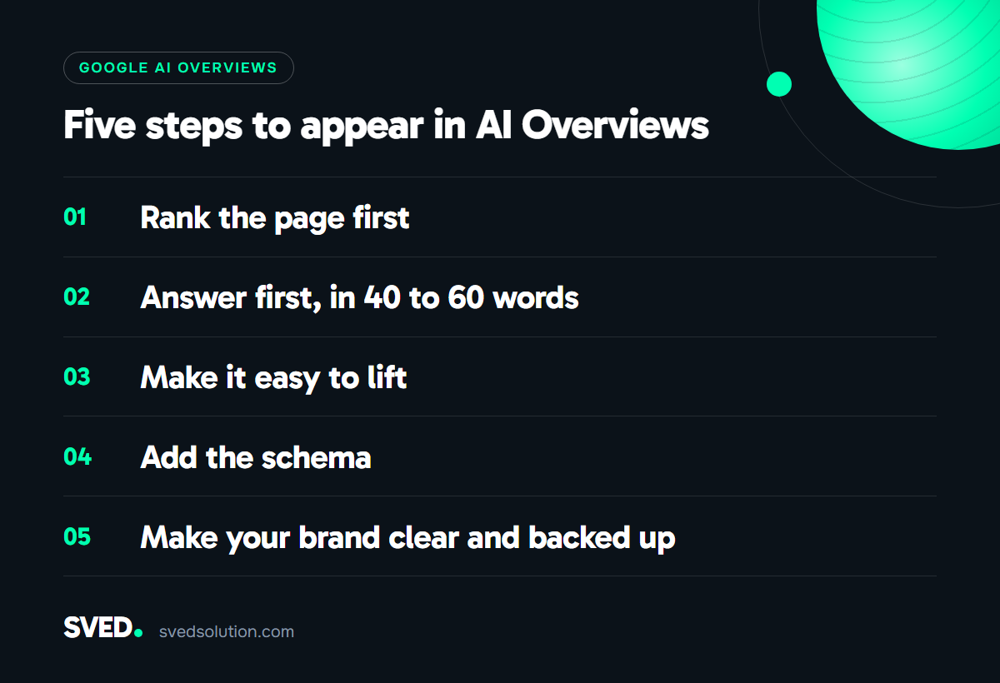

Google AI Overviews now appear on a large and growing share of searches: roughly **48% of tracked queries by early 2026, up from about 31% a year earlier**, while clicks through to websites fell nearly 30% (BrightEdge tracking). The term "google ai overviews" alone gets around **22,200 searches a month**. If your brand is not named inside that summary, you are often unseen at the exact moment the searcher decides. Here is how to get in.

## What is a Google AI Overview?

An AI Overview is the summary, written by AI, that Google places above the normal results. It shows up for many searches where people want information or are comparing things to buy. It answers the question directly and names two or three brands or sources. There is no position one inside it. What counts is which pages Google draws on and which brands it names. When one appears, your page can hold the same ranking it always had while its clicks fall, because the searcher gets the answer without scrolling.

## What actually gets pulled into an AI Overview

Two pages can rank in the same spot and get opposite results. Google prefers the page that makes it easiest to lift an answer it can trust:

| Gets pulled in | Gets skipped |
|---|---|
| Direct answer in the first 100 words | Answer buried three scrolls down |
| Headings written as questions | Vague, clever headings |
| Valid FAQ / Article schema | No structured data |
| A brand described the same way everywhere and backed by other sites | A brand that is anonymous or described in different ways |
| Already ranking on page one | Not yet strong enough to rank for the search |

AI Overviews draw heavily on pages that already rank well. So classic SEO gets you in the door, and a page that is easy to lift an answer from wins the mention. This is the core of our [Google AI Overviews optimization service](/services/google-ai-overviews-optimization/).

## How to appear in Google AI Overviews: the method

<figure style="margin:1.5rem 0"><figcaption style="font-size:.85rem;color:var(--text-faint);margin-top:.7rem;text-align:center">Five steps to AI Overview visibility.</figcaption></figure>

1. **Rank the page first.** AI Overviews mostly draw on page-one results. So the basics come first: relevance, [technical SEO](/services/technical-seo/) and authority.
2. **Answer first.** Open with a direct answer of 40 to 60 words to the exact search, before any background. This is the passage Google lifts. This practice is called [Answer Engine Optimization](/services/answer-engine-optimization/).
3. **Make it easy to lift.** Use H2 headings written as questions, short paragraphs with one idea each, and tables and numbered steps that AI can split into clean pieces.
4. **Add the schema.** `FAQPage`, `Article` and `Organization` structured data (code that labels what is on the page), so Google understands the page and your brand.
5. **Make your brand clear and backed up.** A consistent brand description and mentions on other sites, which is the work of [AI citation and entity building](/services/ai-citation-entity-building/), so Google is confident enough to name you and not a competitor.

## Recover the clicks you're already losing

The fastest wins usually come from protecting what you already have. In Search Console, find pages where clicks dropped while impressions (how often you were shown) and average position held steady. That gap is the sign that an AI Overview is taking the clicks. Rebuild those pages so the answer comes first. Then shift more effort to searches where people are ready to buy and a click still happens. For the wider change behind all of this, see [GEO vs SEO](/insights/geo-vs-seo/) and [what is Answer Engine Optimization](/insights/what-is-answer-engine-optimization/).

## Frequently asked questions

**How do I get my website into Google AI Overviews?**
Rank the page on page one, open with a direct answer of 40 to 60 words, write headings as questions, add FAQ and Article schema, and make your brand clearer with consistent mentions on other sites. There is no form to submit. These steps make a place likely.

**Can you guarantee inclusion in an AI Overview?**
No. Nobody controls what Google writes, and you cannot opt in. What you control is every signal that makes a place likely, tracked month over month.

**Do AI Overviews only pull from top-ranking pages?**
Mostly, yes. They lean on page-one results. That is why classic ranking and a page that is easy to lift an answer from have to work together.

**Are AI Overviews killing my clicks?**
They can. If impressions and position are flat but clicks fell, an AI Overview is likely answering the search above you. The fix is to be named inside the summary and to put more effort into searches where people still click.

**What schema helps with AI Overviews?**
`FAQPage`, `Article` and `Organization` are the most useful types. They help Google understand the page and see your brand as one it can trust.

## The bottom line

Google AI Overviews reward the answer that is clearest, easiest to lift and best backed up by other sites. The highest-ranked link does not always win. Rank the page, answer first, make it easy to lift, add the schema, and build the brand signals Google trusts. Start with our [Google AI Overviews optimization service](/services/google-ai-overviews-optimization/) or run a free AI visibility check. It runs 20 checks on your live URL and needs no card.
