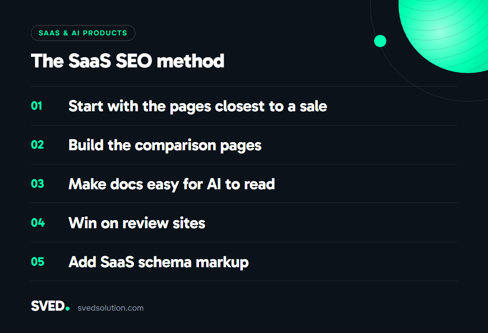

Software buyers now do their research in AI tools. They ask ChatGPT "what's the best tool for X?" and "what are alternatives to Y?" before they ever reach a comparison site. For a SaaS or AI product, **SEO** is no longer mainly about traffic. It is about being the product AI names and Google ranks when a buyer is choosing. Here is the method, built for your sales pipeline.

## Why SaaS & AI product SEO is different

1. **The buyer is ready to buy and specific.** SaaS searches are commercial: comparisons, alternatives, integrations, pricing. Winning those beats ranking a general blog post.
2. **AI is now part of the shortlist.** Buyers ask AI which tool to use. If your product is not named, you are out before the demo.
3. **Documentation helps you rank.** AI tools read docs heavily. Well-organised docs are some of your most quotable content.

That is the focus of our [SaaS and AI product SEO](/saas-ai-product-seo/) work.

## What our SaaS & AI product SEO covers

| What you get | The service | Outcome |
|---|---|---|
| Get named by ChatGPT & Perplexity | [AI citation & entity building](/services/ai-citation-entity-building/) + [AEO](/services/answer-engine-optimization/) | Your product is recommended for the category |
| Rank the pages closest to a sale | [Content strategy](/services/content-strategy/) | Comparison, alternatives, integration traffic |
| Docs and templates AI can read | [LLM SEO](/services/llm-seo/) + [technical SEO](/services/technical-seo/) | Content AI tools can find and quote |
| A presence on review sites | Listings and mentions (G2, Capterra) | The outside proof AI tools look for |

## The shift: buyers ask AI which tool to use

Ask a generative engine (an AI tool such as ChatGPT) for the best CRM, analytics tool or AI writing app. It names a few and points to a few sources, usually review sites, comparison pages and docs. You become a named product through balanced comparison pages, review-site presence and consistent mentions on outside sites. That is [Generative Engine Optimization](/generative-engine-optimization/) (GEO) applied to software, and it is why on-page work alone stops paying off. See [how to rank in ChatGPT](/insights/how-to-rank-in-chatgpt/).

## The SaaS SEO method

<figure style="margin:1.5rem 0"><figcaption style="font-size:.85rem;color:var(--text-faint);margin-top:.7rem;text-align:center">The SaaS & AI product SEO method.</figcaption></figure>

1. **Start at the bottom of the funnel.** Publish the pages closest to a sale first, where revenue is nearest.
2. **Build the comparison pages.** Versus, alternatives and best-of pages, written fairly so they get quoted.
3. **Make docs easy for AI to read.** Clean docs in short sections that start with the answer.
4. **Win on review sites.** G2, Capterra and Product Hunt presence, plus category directories.
5. **Add SaaS schema markup.** `SoftwareApplication`, `Product`, `Review` and `FAQPage`, the code that labels your pages.

## Frequently asked questions

**What is SaaS SEO?**
Setting up a software brand to win buying searches and AI recommendations, through comparison and alternatives pages, docs, review sites and outside mentions. It is built for sales leads rather than page views.

**How does a SaaS product get recommended by ChatGPT?**
Through balanced comparison content, review-site presence and consistent mentions across the sites AI trusts, plus docs organised so AI tools can read them.

**Are comparison pages against competitors risky?**
Handled fairly, no. Accurate comparisons that admit where a competitor is stronger build trust. They get quoted because they read as balanced.

**How long until SEO produces pipeline?**
For pages closest to a sale, where Google competition is light, first qualified leads typically appear in 60–90 days. Broad authority takes 9–12 months.

**Does this apply to AI-native products?**
Especially. AI products compete in fast, crowded categories, where being an AI tool's default recommendation can decide who wins.

## The bottom line

SaaS and AI product SEO is about sales leads: rank the commercial pages and get named by AI when buyers are choosing. Publish the pages closest to a sale, build comparison pages, tidy the docs and win on review sites. [Explore our SaaS and AI product SEO](/saas-ai-product-seo/) or run a free AI visibility check: 20 checks on your live URL, no card required.
