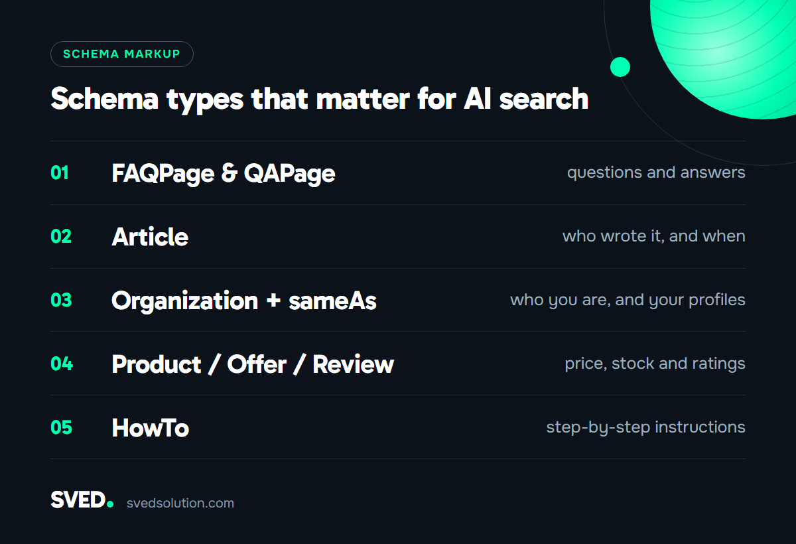

AI language models and Google's AI Overviews (the AI summaries above the results) reward content they can understand without any doubt. You give them that understanding with **schema markup for AI search**. It is structured data: code that tells machines exactly what a page is, what the questions and answers are, and who your brand is. Here is which schema types matter in 2026 and how to add them.

## What is schema markup for AI search?

Schema markup is structured data, usually written in a format called JSON-LD. You add it to a page to describe the content, and the brands, people and products it mentions, in a way machines can read. For AI search it does two jobs. It makes a page's answers easy to pick out. And it helps an AI tool see your brand as one consistent, trustworthy identity. That is why it sits at the heart of both [technical SEO](/services/technical-seo/) and [LLM SEO](/services/llm-seo/), the work of making your site easy for AI language models to read.

## The schema types that matter most in 2026

| Schema type | What it does | Why it matters for AI |
|---|---|---|
| `FAQPage` / `QAPage` | Marks questions and answers | The format AI tools quote most |
| `Article` | Headline, author, dates | Shows context and how fresh the page is |
| `Organization` + `sameAs` | Confirms who your brand is | One consistent identity across the web |
| `Product` / `Offer` / `Review` | Price, availability, ratings | Shopping answers and AI Overviews |
| `HowTo` | Step-by-step processes | Steps an AI tool can lift out |

FAQ and QAPage markup gives the most return for the effort. It matches the way AI answers and Google's People Also Ask box work, and it is the format most often pulled into an AI Overview. It pairs directly with [Answer Engine Optimization](/services/answer-engine-optimization/) (AEO).

## How schema helps you get cited

Schema cannot force AI to include you. There is no way to submit your site. What it does is remove doubt in two ways. First, **picking out answers**: clean FAQ and HowTo markup gives an AI tool a complete answer it can lift. Second, **confirming who you are**: `Organization` with `sameAs` links (your profiles, listings and social accounts) helps an AI tool confirm your brand is one consistent identity. That is the base of [AI citation and entity building](/services/ai-citation-entity-building/), where an AI citation means an AI answer using your site as a source. For the bigger picture, see [what is GEO](/insights/what-is-generative-engine-optimization/).

## How to add schema correctly

<figure style="margin:1.5rem 0"><figcaption style="font-size:.85rem;color:var(--text-faint);margin-top:.7rem;text-align:center">The schema types that matter most for AI search.</figcaption></figure>

1. **Match schema to what is visible on the page.** Every FAQ in your markup must also appear on the page. Mismatches get ignored or penalised.
2. **Use JSON-LD.** It is Google's preferred format and the easiest to maintain.
3. **Start with FAQ, Article and Organization.** Begin with the most valuable types, then add Product or HowTo where relevant.
4. **Test it.** Run the page through Google's Rich Results Test and fix every error and warning.
5. **Keep it consistent.** Use one standard brand description in every `Organization` block and profile.

## Frequently asked questions

**What schema is best for AI search?**
`FAQPage` and `QAPage` are the most valuable because AI tools quote that format most. Next come `Article` and `Organization` with `sameAs`, which confirm who your brand is.

**Does schema guarantee I'll appear in AI Overviews?**
No. Nothing does, and there is no way to submit your site. Schema makes it more likely by removing doubt and making your answers easier to pick out.

**Is JSON-LD better than microdata for AI?**
Yes. JSON-LD is Google's preferred format, it is easier to maintain, and AI tools can read it cleanly.

**Does FAQ schema still work in 2026?**
Yes, especially for AI. It matches the way AI answers and People Also Ask (PAA) are laid out, and it is one of the most quoted formats, as long as it matches what is visible on the page.

**How do I know my schema is working?**
Test it in Google's Rich Results Test, and watch the Enhancements reports in Search Console for FAQ, Breadcrumb and Article coverage.

## The bottom line

Schema markup for AI search is the cheapest way to make your content clear to machines. Add FAQ, Article and Organization JSON-LD, match it to what is visible on the page, and test it. Start with our [technical SEO](/services/technical-seo/) and [LLM SEO](/services/llm-seo/) services or run a free AI visibility check: 20 checks on your live URL, no card required.
