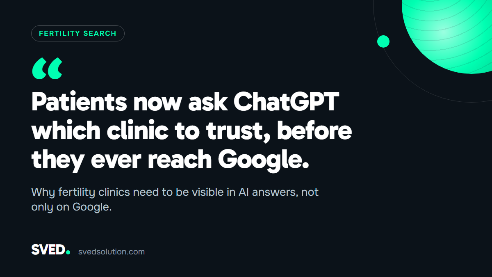

If you searched for **SEO services for fertility** clinics, an **IVF SEO agency**, or a **fertility AI SEO agency**, you are in the right place. SVED Solution is the **AI visibility agency for fertility** practices. We help your clinic rank on Google and get named by the AI tools patients now ask before they book. This page covers what we do, why fertility is different, and how to start.

## Why fertility clinics need a specialist SEO agency

Fertility is a health topic, and Google is extra careful with health and money topics (known as YMYL, or Your Money or Your Life). Google and AI tools look closely at who wrote the content, whether a doctor reviewed it, and whether other sites back it up. A general agency that uses the same method it uses for online shops will not get results. Thin content with no named author will never rank or be mentioned by AI. You need a **fertility AI search agency** that understands E-E-A-T for medical content (Google's test of experience, expertise and trust), the long time patients spend researching, and the AI answers that now sit above Google's results.

That is the focus of our [healthcare, IVF and clinic SEO](/healthcare-ivf-seo/) work.

## What our SEO services for fertility clinics include

Every project is built around the two things that win patients today: a top position on Google and a mention inside the AI answer.

| What you get | The service | Outcome for your clinic |
|---|---|---|
| Get named by ChatGPT, Perplexity & Gemini | [Answer Engine Optimization](/services/answer-engine-optimization/) + [AI citation building](/services/ai-citation-entity-building/) | Your clinic is the one AI recommends |
| Rank for treatment & condition searches | [Content strategy](/services/content-strategy/) with medical E-E-A-T | Featured snippets + visitors who are likely to book |
| Win every location | [Local SEO](/services/local-seo/) | A place in Google's map results and more booked consultations |
| A site AI and Google can trust | [Technical SEO](/services/technical-seo/) + medical schema | Pages reach Google faster and show richer results |

As a combined **IVF SEO agency** and **AI visibility agency for fertility**, we run all of it together. AI visibility does not work on a broken site that nobody trusts.

## The shift: patients ask AI before they reach Google

<figure style="margin:2rem 0"><figcaption style="font-size:.85rem;color:var(--text-faint);margin-top:.7rem;text-align:center">The fertility research journey has moved upstream into AI answers.</figcaption></figure>

Ask ChatGPT or Perplexity to recommend a fertility clinic. It names a handful of clinics and a handful of sources. There is no position one, only the clinics that get named. Because fertility is a health topic, AI tools lean even harder on clinics with clear credentials, the same description everywhere and backing from other sites. That is what a **fertility AI SEO agency** builds. It is also why being missing from AI answers is now the most expensive gap in fertility marketing. (For how it works, see [how to rank in ChatGPT](/insights/how-to-rank-in-chatgpt/) and [GEO vs SEO](/insights/geo-vs-seo/).)

## How we get fertility & IVF clinics found and recommended

1. **Medical E-E-A-T on every page.** Named doctors, their credentials, review dates and medically reviewed content. This is the base of trust that both Google and AI tools need.
2. **Treatment content that answers first.** Success rates by age, ICSI vs IVF, egg-freezing timelines. These are the questions patients really search. We answer them in the first 100 words, so you can win featured snippets (Google's answer box) and AI mentions at the same time.
3. **Local SEO for each location.** A well-kept Google Business Profile, the same name, address and phone number everywhere (NAP), a steady flow of new reviews, and a page Google can list for every clinic. This is where most ready-to-book demand lives.
4. **Medical schema.** `MedicalClinic`, `Physician`, `MedicalProcedure` and `FAQPage` markup. Schema markup is code that tells search engines and AI tools exactly what you are.
5. **Mentions on trusted sources.** A consistent presence across credentialed directories, health platforms and the press. When independent sites agree about you, AI is confident enough to name your clinic.

## Why SVED Solution

We are a 360° SEO and AI visibility agency. We have worked since 2018 across healthcare, IVF and dermatology, among ten industries in four countries. We report AI mentions as a number we measure, and we never promise them. We also tell you the honest timeline. Treatment and local pages typically move in 60 to 90 days. Search and AI tools pick up who your clinic is at 30 to 45 days, with first AI mentions around day 60. Lasting authority comes at 9 to 12 months. No one can guarantee a ranking or an AI mention in a health niche. But every input is within your control, and we do the work instead of only recommending it.

## Frequently asked questions

**What do your SEO services for fertility clinics include?**
Medically reviewed treatment content, local SEO for each location, medical schema, technical SEO and mentions on trusted sites. We also do AI visibility work, so your clinic is named by ChatGPT, Perplexity and Google's AI Overviews as well as ranked. See our [healthcare & IVF SEO](/healthcare-ivf-seo/) page.

**Are you an IVF SEO agency or a fertility AI SEO agency?**
Both. We run traditional SEO (rankings, local, technical) and AI search visibility (GEO, AEO and AI mentions) as one program. In fertility, each one helps the other.

**How does an AI visibility agency for fertility get us named by ChatGPT?**
By making it clear to AI tools who your clinic is. That takes qualified doctors, the same description everywhere, content that answers first, medical schema, and mentions that back you up on sources AI already trusts.

**Is SEO worth it for a fertility clinic with low keyword volume?**
Yes. Few people search the exact terms and few clinics compete for them, so they are cheap to win. One IVF patient is worth a great deal over time, so a few good consultations a month can pay for the whole program.

**How do we start?**
Run a free AI visibility check. It runs 20 checks on your live URL and needs no card. We then show you exactly where your clinic stands on both Google and AI.

## Book your free fertility AI visibility audit

Your patients are already asking AI which clinic to trust. Make sure the answer is you. [Explore our healthcare & IVF SEO](/healthcare-ivf-seo/) or run a free AI visibility check today. Google ranks pages, AI recommends brands, and we help fertility clinics become the brand AI recommends.
