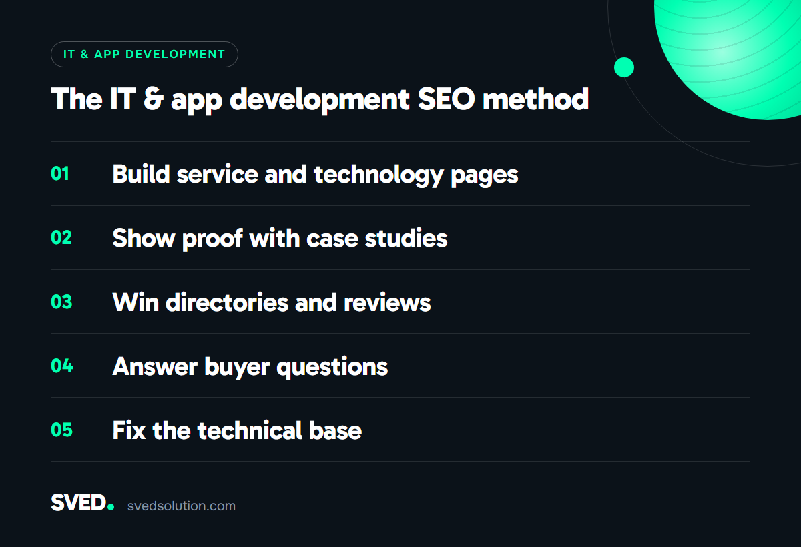

Buyers looking for a software partner now research the way everyone else does: they ask AI. They type "Who's the best React Native app development company?" or "top IT services firm for X?" and shortlist the names it gives back. For an IT services or app development company, **SEO** now means winning those ready-to-hire searches *and* being the firm AI recommends. Here is how to do it.

## Why IT & app development SEO is different

1. **The searches are specific and come from buyers.** Buyers search by technology, service and location, such as "Flutter app developers" or "IT support for healthcare". They do not use general terms, and winning those searches beats ranking a broad blog post.
2. **Trust is everything in B2B services.** A build is a big commitment, so case studies, reviews and what independent sites say about you carry the decision.
3. **AI is now part of the shortlist.** If your firm is not named when a buyer asks AI for recommendations, you are out before the request for proposal (RFP) is even written.

That is the focus of our [IT services and app development SEO](/it-services-app-development-seo/) work.

## What our IT & app development SEO covers

| What you get | The service | Outcome |
|---|---|---|
| Get named by ChatGPT & Perplexity | [AI citation & entity building](/services/ai-citation-entity-building/) + [AEO](/services/answer-engine-optimization/) | Your firm is recommended for the technology and location |
| Rank service & technology pages | [Content strategy](/services/content-strategy/) | Visitors who are ready to hire |
| A site AI can read | [Technical SEO](/services/technical-seo/) + [LLM SEO](/services/llm-seo/) | Pages AI tools can find and quote |
| Directory & review presence | Listings and mentions (Clutch, GoodFirms) | Independent backing, which AI tools reward |

## The shift: buyers ask AI who to hire

Ask an AI tool for the best app development or IT services firm for a particular need. It names a few firms and points to a few sources, usually review platforms, directories and case studies. You become one of the named firms through balanced case studies, a presence in directories and consistent mentions elsewhere. (An AI citation is an AI answer using your site as a source.) That is [Generative Engine Optimization](/generative-engine-optimization/), or GEO, applied to tech services. See [how to rank in ChatGPT](/insights/how-to-rank-in-chatgpt/).

## The IT & app development SEO method

<figure style="margin:1.5rem 0"><figcaption style="font-size:.85rem;color:var(--text-faint);margin-top:.7rem;text-align:center">The IT & app development SEO playbook.</figcaption></figure>

1. **Build service and technology pages.** One page for each service and each technology (React, Flutter, .NET, cloud), aimed at the searches real buyers make.
2. **Show proof.** Case studies with real results, plus Review/Organization schema (code that labels your reviews and company details for machines).
3. **Win directories and reviews.** Clutch, GoodFirms and the directories for your category. Both buyers and AI look there.
4. **Answer buyer questions.** Cost, timelines, ways of working together, technology comparisons. Answer each one directly.
5. **Fix the technical base.** Fast, server-rendered pages that search engines can read, so AI can pick out the content.

## Frequently asked questions

**What is SEO for IT services and app development companies?**
Setting up service, technology and case-study pages to win searches from buyers ready to hire and to earn AI recommendations, plus directory listings and mentions on other sites, so buyers find and trust the firm.

**How do software firms get recommended by ChatGPT?**
Through balanced case studies, a presence on review platforms like Clutch and GoodFirms, and consistent mentions on sources AI trusts.

**Which pages should we build first?**
Service and technology pages for buyers closest to hiring, tied to the searches they really make. These turn into enquiries fastest and pay for the rest of the programme.

**Is SEO worth it for a B2B tech firm?**
Yes. Deal values are high, so a handful of qualified enquiries a month from ready-to-hire searches and AI recommendations pays for the investment.

**How long until we see leads?**
For pages aimed at buyers close to hiring, where the competing Google results are weak, the first qualified enquiries typically appear in 60–90 days. Broad authority takes 9–12 months.

## The bottom line

IT services and app development SEO comes down to winning searches from buyers who are ready to hire and being the firm AI names when they shortlist. Build service and technology pages, show proof, win directories, and answer buyer questions. [Explore our IT services and app development SEO](/it-services-app-development-seo/) or run a free AI visibility check: 20 checks on your live URL, no card required.
