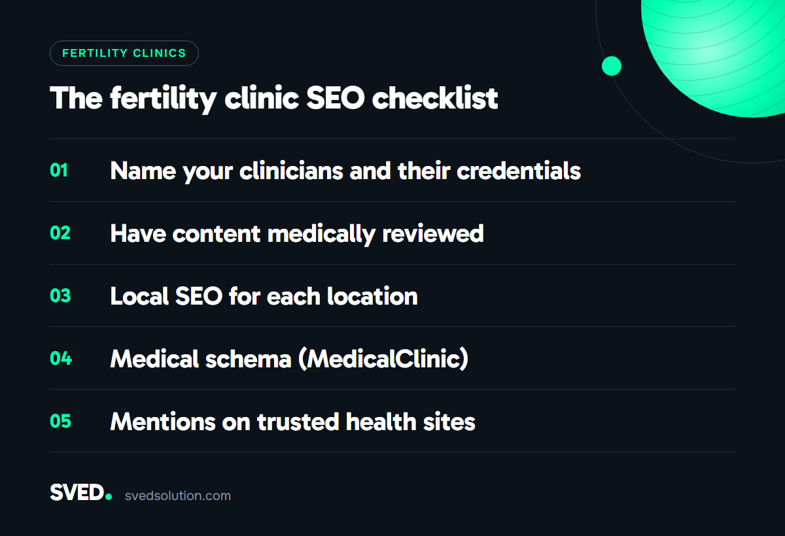

Fertility patients research for weeks. More and more of them also ask ChatGPT or Google's AI Overview (the AI summary above the results) which clinic to trust before they book. If you run or market an IVF or fertility clinic, this is the practical **SEO checklist** for getting found on Google *and* recommended by AI. (For the full strategy, see our [SEO for fertility & IVF clinics](/insights/seo-for-fertility-ivf-clinics/) guide.)

## Why fertility clinic SEO needs its own checklist

Fertility is a Your-Money-or-Your-Life (YMYL) topic: a health or money subject where Google is extra careful. So Google and AI tools look closely at who is publishing, their credentials, and whether independent sources back them up. Google's test for this is called E-E-A-T: experience, expertise, authoritativeness and trust. A general SEO checklist misses the medical trust signals that decide whether a clinic ranks and gets recommended. That is the focus of our [healthcare, IVF and clinic SEO](/healthcare-ivf-seo/) work.

## The IVF & fertility clinic SEO checklist

<figure style="margin:1.5rem 0"><figcaption style="font-size:.85rem;color:var(--text-faint);margin-top:.7rem;text-align:center">The fertility clinic SEO checklist.</figcaption></figure>

| # | Checklist item | Why it matters |
|---|---|---|
| 1 | Name your clinicians, with credentials and review dates | Medical E-E-A-T: the base of trust |
| 2 | Have treatment content medically reviewed, and say so | Google and AI favour verified health content |
| 3 | Answer patient questions in the first 100 words | Wins Google's answer boxes and AI mentions |
| 4 | A dedicated page for each location that Google can index | You are found in each area you serve |
| 5 | A complete Google Business Profile and a steady flow of reviews | Map results and trust |
| 6 | MedicalClinic, Physician and FAQPage schema | Tells machines who the clinic and its doctors are |
| 7 | The same name, address and phone number (NAP) in every directory | Stops you looking like several different clinics |
| 8 | Mentions on health sites with real credentials | Independent backing, which AI rewards |

## Answer the questions patients actually search

Fertility patients search in questions: IVF success rates by age, ICSI vs IVF, egg-freezing timelines, cost and funding, what a first consultation involves. Open each page with a direct, accurate answer in the first 100 words. Then support it with headings, lists and tables an AI tool can pick out. This wins featured snippets (Google's answer boxes) and AI mentions at once. That is [Answer Engine Optimization](/services/answer-engine-optimization/) built on a real [content strategy](/services/content-strategy/).

## Get recommended by AI, not just ranked

Ask an AI tool to recommend a fertility clinic and it names a few and points to a few sources. Because fertility is a health topic, AI tools lean hard on clinics with clear credentials, a consistent description and independent backing. That makes [AI citation and entity building](/services/ai-citation-entity-building/) decisive: getting the clinic mentioned, and described the same way, on trusted health sites. Local visibility matters too. A fertility clinic is a local business that draws patients from a wide area, so [local SEO](/services/local-seo/) for each location is where much of the bookable demand is.

## Frequently asked questions

**What does SEO for a fertility clinic involve?**
Doctor-reviewed treatment content, local SEO for each location, medical schema, consistent mentions on health sites, and AI visibility work so that ChatGPT and AI Overviews name the clinic.

**Do I need a fertility SEO consultant or an agency?**
Either can work if they understand medical E-E-A-T and YMYL. What matters is whether they build the credentialed content and trusted mentions that fertility needs, rather than general link building.

**How do fertility clinics get into AI Overviews and ChatGPT?**
Through content that shows credentials and answers the question first, medical schema, and supporting mentions on sources the AI tools already trust.

**Is SEO worth it for a clinic with low search volume?**
Yes. The search terms have little competition and are cheap to win. A single IVF patient is worth a great deal over time, so a few qualified consultations a month pay for the work.

**How long before results show?**
Treatment and local pages typically improve in 60–90 days. AI mentions follow: the clinic is recognised by AI tools at 30–45 days, and the first mentions come around day 60.

## The bottom line

Fertility clinic SEO comes down to trust at both ends: ranking on Google and being named by AI. Both are earned through medical E-E-A-T, local visibility, schema and trusted mentions. Work through the checklist above, or [explore our healthcare and IVF SEO](/healthcare-ivf-seo/) and run a free AI visibility check: 20 checks on your live URL, no card required.
