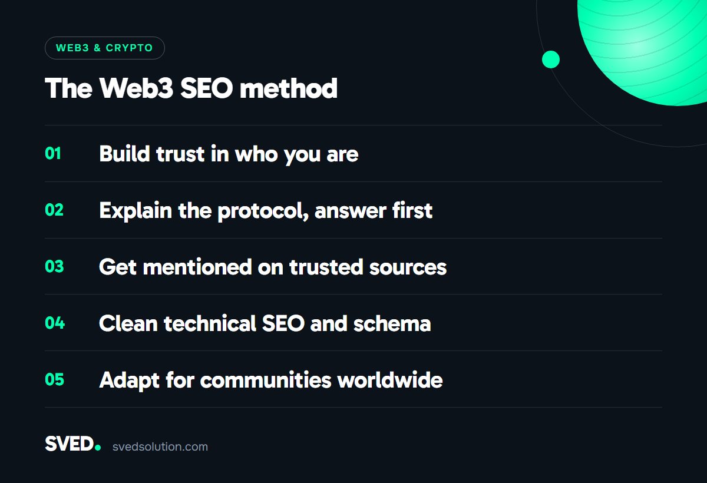

If you searched for a **Web3 SEO agency** or a **crypto SEO** partner, you already know that normal SEO does not work well in this niche. Few people search the exact terms, trust is hard to earn, the vocabulary changes every month, and more buyers now ask ChatGPT or Perplexity "which protocol should I use?" before they touch Google. SVED Solution helps blockchain brands rank on Google **and** get named by AI. Our subsidiary, Web3Tech Network, works only in blockchain and Web3 marketing. Here is how it works.

## Why Web3 and crypto SEO is different

Three facts about this market change the method:

1. **Google and AI look at it more closely.** Crypto sits next to money and risk, so Google's quality checks and AI tools are extra careful. They prefer projects with credentials, backing from other sites and a clean track record over anonymous ones.
2. **Trust is the limit, more than traffic.** A token or DeFi protocol lives or dies on whether people think it is legitimate. Content has to build that trust again and again across a long, sceptical research period.
3. **The search terms are tiny but the deals are large.** Exact searches like `web3 seo` or `crypto seo` barely show up on volume tools, yet a single funded project is worth far more than a mass-market keyword. The value lies in what the searcher wants and how much they trust you, more than in volume.

That is why a general agency struggles here. It is also why our [Web3, crypto and blockchain SEO](/web3-crypto-seo/) work starts with making the project known and trusted, before keyword volume.

## What our Web3 & crypto SEO services cover

| What you get | The service | Outcome |
|---|---|---|
| Get named by ChatGPT, Perplexity & Gemini | [AI citation & entity building](/services/ai-citation-entity-building/) + [Answer Engine Optimization](/services/answer-engine-optimization/) | Your protocol is the one AI recommends |
| Rank for protocol, token & use-case terms | [Content strategy](/services/content-strategy/) | The right visitors from search and a growing community |
| A site AI and Google can trust | [Technical SEO](/services/technical-seo/) + schema | Pages reach Google faster and are easier for AI to read |
| Standing across the crypto web | Mentions on trusted crypto sources | The outside backing that AI tools and Google reward |

## The shift: users ask AI which protocol to trust

Ask an AI tool to recommend a wallet, chain, DeFi platform or launchpad. It names a few and lists a few sources. Because crypto is high-risk, AI tools lean hard on projects that other sites back up and describe in the same way. A Web3 brand with a thin web presence full of jargon does not appear in those answers. One that works on purpose to be clearly known and trusted becomes the default recommendation. That is [Generative Engine Optimization](/generative-engine-optimization/) (GEO, the work of getting named in AI answers) applied to blockchain. See [how to rank in ChatGPT](/insights/how-to-rank-in-chatgpt/) for how it works.

## The Web3 SEO method

<figure style="margin:1.5rem 0"><figcaption style="font-size:.85rem;color:var(--text-faint);margin-top:.7rem;text-align:center">The Web3 & crypto SEO method.</figcaption></figure>

1. **Build trust in who you are.** Use the same project name and description on your site, block explorers, listings, GitHub, docs and the crypto press. AI and Google read that agreement as a sign you are legitimate.
2. **Explain the protocol, answer first.** Open pages with a direct answer to real questions: how staking works, fees, the security model, tokenomics. Then both users and AI tools can take a clean answer.
3. **Get mentioned on trusted sources.** Be present, and described the same way, across the crypto directories, data aggregators and publications AI tools already draw on.
4. **Clean technical SEO and schema.** Docs that can be crawled, load fast and are rendered on the server, plus `Organization`/`FAQPage` schema (code that tells machines who you are). Most Web3 sites are JavaScript shells that AI crawlers cannot read.
5. **Adapt for communities around the world.** Crypto has no borders. Pages for each market and clear language beat jargon.

## Frequently asked questions

**What does a Web3 SEO agency do?**
It helps blockchain, DeFi, NFT and token projects rank on Google and appear in AI answers. The work covers technical SEO, protocol content, a clear brand identity and mentions on trusted sites, so the project is found and trusted.

**How is crypto SEO different from normal SEO?**
The base is the same. The difference is trust. Crypto gets closer checks, so being clearly known and backed by independent sites matters far more, and AI tools are more careful about which projects they name.

**How do Web3 projects get cited by ChatGPT or Perplexity?**
By being a project that is described the same way everywhere and backed by other sites. That means docs that answer first, clean schema, and mentions on the trusted crypto sources AI tools already use.

**Is SEO worth it for a crypto project with low search volume?**
Yes. Few people search the exact terms and few sites compete for them, so they are cheap to win. A single funded project has very high value. Trust and what the searcher wants matter more than raw volume.

**Do you have Web3 experience?**
Yes. Our subsidiary Web3Tech Network works only in blockchain and Web3 marketing, so crypto is a core skill for us and never an add-on.

## The bottom line

Web3 and crypto SEO is about trust at every stage. You need to rank on Google and get named by AI. Both are earned by being clearly known and backed by other sites, more than by keyword volume. [Explore our Web3, crypto and blockchain SEO](/web3-crypto-seo/) or run a free AI visibility check. It runs 20 checks on your live URL and needs no card.
