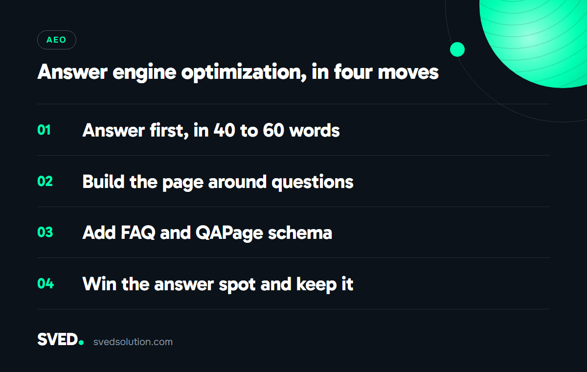

More and more, search gives one answer instead of a list of links. Google shows a featured snippet (the answer box at the top) or an AI Overview (a summary written by Google's AI). ChatGPT and Perplexity reply with a short answer that names a few sources. **Answer Engine Optimization (AEO) is how you make your page the answer they use.** Roughly 2,400 people a month search "answer engine optimization" as they try to keep up. Here is what it is, how it works, and how it differs from SEO and GEO.

## What is Answer Engine Optimization?

AEO means setting up a page so a search engine or AI tool can take a clean, direct answer from it and show that answer at the top. The answer can appear as a featured snippet, a People Also Ask (PAA) entry, or the summary in an AI Overview or chatbot reply. Classic SEO works to rank a page in a list. AEO works to get the page *quoted as the answer*.

AEO deals with one page at a time and with how that page is built. The work happens on the page itself: the wording of your headings, whether you answer the question in the first 100 words, and whether your markup (the code behind the page) tells machines "this is a question and this is its answer." That is the core of our [Answer Engine Optimization service](/services/answer-engine-optimization/).

## AEO vs SEO vs GEO

The three are sold separately because the work and the timelines differ:

| | SEO | AEO | GEO |
|---|---|---|---|
| **Goal** | Rank in the list | Be the direct answer | Get named across AI answers |
| **Works on** | Page | Page + question | Brand |
| **What drives it** | Relevance + backlinks | Page structure + FAQ/QAPage schema | A clear brand identity + mentions on other sites |
| **Shows up as** | Blue links | Snippets, PAA, AI Overview answer | ChatGPT, Perplexity, Gemini mentions |
| **Speed** | Weeks–months | Fastest feedback | Slowest, hardest for rivals to copy |

AEO gives the fastest feedback of the three. The same work that makes a page easy for an AI tool to quote also wins featured snippets in classic search. GEO (generative engine optimization) gets AI tools to *remember* your brand. AEO makes your page *quotable*. You generally need both. See [what is GEO](/insights/what-is-generative-engine-optimization/) and [GEO vs SEO](/insights/geo-vs-seo/) for the fuller picture.

## How Answer Engine Optimization works

<figure style="margin:1.5rem 0"><figcaption style="font-size:.85rem;color:var(--text-faint);margin-top:.7rem;text-align:center">Answer Engine Optimization, in four moves.</figcaption></figure>

1. **Answer first.** Open the page with a direct answer of 40 to 60 words to the exact question the page targets, before any story or background. This is the passage a snippet or AI answer takes.
2. **Build the page around questions.** Use real questions as H2 headings. Keep paragraphs short, with one idea each. Add tables or numbered steps that a machine can pull out cleanly.
3. **FAQ & QAPage schema.** Schema markup is code that labels what is on a page. Question-and-answer markup is the format AI answer tools quote from most often, and it lines up directly with People Also Ask. Add `FAQPage` and, where relevant, `QAPage` and `HowTo` schema.
4. **Win the spot and keep it.** Go after the featured snippet and PAA boxes for the searches that bring you money. Then protect that visibility as AI Overviews take more of the clicks. This is where [technical SEO](/services/technical-seo/) and a planned [content strategy](/services/content-strategy/) meet.

## Why AEO matters now

As answers move above the traditional results, the page that gets quoted gets the attention, and often the click that is left. If a competitor's page is the quoted answer and yours is link number four, they get the attention you worked for. AEO is also the cheapest, fastest way into AI search. You control every input, and results show up in weeks instead of the months GEO takes. For the step-by-step on the AI side, see [how to rank in ChatGPT](/insights/how-to-rank-in-chatgpt/).

## Frequently asked questions

**What is Answer Engine Optimization in simple terms?**
It means setting up a page so it becomes the direct answer shown in search or AI, instead of just another link. That answer could be the featured snippet, the People Also Ask box, or the summary at the top of an AI Overview.

**Is AEO the same as SEO?**
No. SEO ranks a page in a list. AEO makes a page the answer that gets quoted for a specific question. They share the same technical basics, but AEO adds headings built around questions and schema built around answers.

**What is the difference between AEO and GEO?**
AEO works on the page and how it is built, so the page is easy to quote. GEO works on the brand and its reputation, so an AI tool remembers and names your brand. AEO shows results faster. GEO is harder for rivals to copy. Most brands need both.

**What schema does AEO use?**
Mainly `FAQPage` and `QAPage`, plus `HowTo` for processes and `Article` for context. Question-and-answer markup is the format AI answer tools quote from most often.

**How long does AEO take to work?**
It is the fastest of the AI search methods. Featured snippet and PAA gains often appear within weeks of rebuilding a page. GEO mentions typically take 60 to 90 days.

## The bottom line

Answer Engine Optimization is the quickest way to stay visible as search moves from links to answers. Lead with a direct answer, build content around real questions, add FAQ and QAPage schema, and win the snippet and AI answer spots. Start with our [Answer Engine Optimization service](/services/answer-engine-optimization/) or run a free AI visibility check. It runs 20 checks on your live URL and needs no card.
