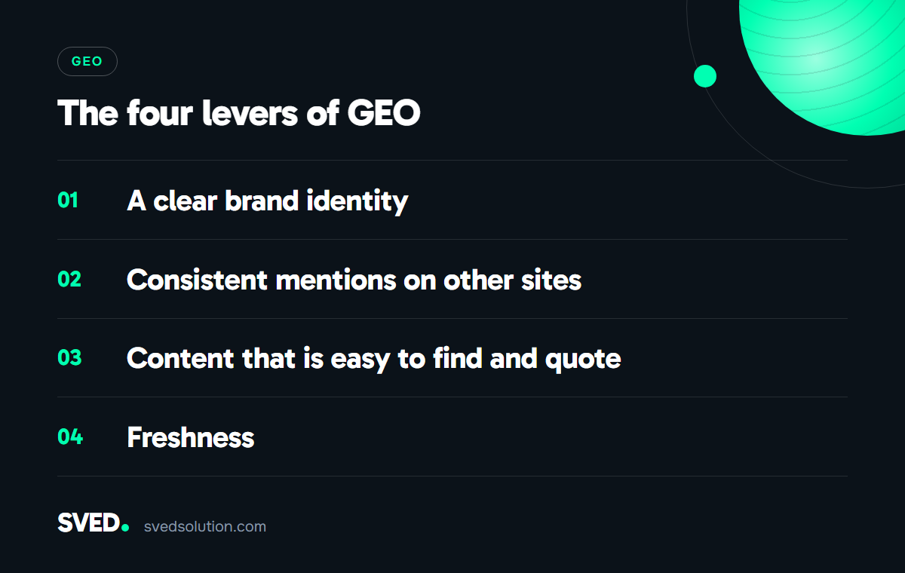

Ask ChatGPT, Perplexity or Google's AI Overview a buying question and you get an answer in place of ten blue links. That answer names a few brands and points to a few sources. **Generative Engine Optimization (GEO) is how you become one of those named brands.** Searches for "what is generative engine optimization" have climbed roughly 120% year over year, because every business that relied on Google rankings now has a second visibility problem to solve. Here is what GEO is, how it works, and how to start.

## What is Generative Engine Optimization?

GEO is the work of shaping a brand so that AI tools find it, trust it and mention it when they write answers. Traditional SEO competes for a **position in a ranked list**. GEO competes to be the **brand a model names inside a generated answer**. An AI answer has no position one. What matters is which brands get mentioned and which sources get used.

That single difference changes what you work on. In a ranked list, a better page can push out a competitor on the strength of that page alone. In an AI answer, the AI tool isn't comparing your page to a competitor's. It is recalling which brands it connects with the question, then finding sources to back that up. GEO is the work of building that connection. (For the full comparison, see [GEO vs SEO](/insights/geo-vs-seo/).)

## GEO vs SEO vs AEO: the quick distinction

| | SEO | GEO | AEO |
|---|---|---|---|
| **Competes for** | A ranking position | Being named in an AI answer | Owning a specific direct answer |
| **Level** | Page | Brand | Page + question |
| **Main driver** | Relevance + backlinks | A clear brand identity + mentions | Structure + FAQ schema |
| **Where it shows** | Google results | ChatGPT, Perplexity, Gemini | Snippets, AI Overviews |

The three overlap and are often sold together. [Answer Engine Optimization](/services/answer-engine-optimization/) (AEO) makes a page easy to quote. GEO makes a brand easy for the AI tool to remember. You generally need both.

## The four levers of GEO

<figure style="margin:1.5rem 0"><figcaption style="font-size:.85rem;color:var(--text-faint);margin-top:.7rem;text-align:center">GEO works through four reinforcing levers.</figcaption></figure>

1. **A clear brand identity (entity authority).** The AI tool must recognise your brand as one clear, consistent business: one official name and one description, backed up across the web. This is the foundation, and most sites muddle their own identity before anyone else does. It is the core of [AI citation & entity building](/services/ai-citation-entity-building/).
2. **Consistent mentions on other sites (citation consensus).** When an AI tool sees your brand described the same way across sources it already trusts, it treats that repetition as agreement. This off-site signal is the strongest driver of whether you get named, and the one classic SEO barely touches.
3. **Content that is easy to find and quote (retrieval-ready content).** Pages that give the answer first, headings written as questions, tables and a clean layout, so an AI tool can pull out a passage and credit it to you. Content that only appears after JavaScript runs in the browser is often invisible to AI crawlers, the programs that fetch pages for AI tools. That is a matter for [technical SEO](/services/technical-seo/) and [LLM SEO](/services/llm-seo/), which is SEO for large language models, the technology behind tools like ChatGPT.
4. **Freshness.** Newer content counts for more, so your most important pages are updated on a regular routine and show visible dates.

## Why GEO matters now

AI answers increasingly sit above the traditional results and take the click. A brand that builds a clear identity early becomes the default the AI tool reaches for. A brand that starts late is trying to push out a rival the AI tool already trusts, which gets more expensive every quarter. How to earn those mentions is covered step by step in [how to rank in ChatGPT](/insights/how-to-rank-in-chatgpt/).

## How to start with GEO

Fix the technical foundation first, because both SEO and GEO depend on it. Next, run AEO on your money pages (the pages closest to a sale) for fast feedback. Then run GEO continuously in the background. It is the slowest to show results and the hardest for rivals to undo once it is in place. A realistic timeline: AI tools start to recognise your brand at 30–45 days, first mentions come around day 60, and consistent mentions by day 90. No one controls these models and there is no way to submit your site, so anyone guaranteeing a mention is guessing.

## Frequently asked questions

**What is Generative Engine Optimization in simple terms?**
It is SEO for AI answers. It makes your brand the one ChatGPT, Perplexity and Gemini name and use as a source when they respond, so you are more than one of ten links in a list.

**Is GEO the same as SEO?**
No. They share a technical foundation, but SEO competes for a ranking position while GEO competes to be named inside an AI answer. GEO is driven mainly by a clear brand identity and mentions on other sites.

**How do you measure GEO?**
There is no rank to track. You measure how often you are mentioned, your share of mentions against competitors, and which sources an AI tool uses. You test this with a fixed set of prompts (test questions), on a regular routine, across the main AI tools.

**How long does GEO take to work?**
AI tools typically start to recognise your brand at 30–45 days. First mentions come around day 60, consistent mentions by day 90, and a lasting lead in your category at 9–12 months.

**Can I do GEO myself?**
Parts of it. Schema markup (code that labels your content for machines), answer-first structure and freshness can be done in-house once the standard is set. The harder pieces are building mentions on other sites and running controlled prompt tests on a regular routine.

## The bottom line

Generative Engine Optimization is no longer optional. It is how brands stay visible as search moves from links to answers. Build a clear brand identity, earn consistent mentions, structure content so it is easy to quote, and keep it fresh. Start with our [Generative Engine Optimization services](/generative-engine-optimization/) or run a free AI visibility check: 20 checks against your live URL, no card required.
