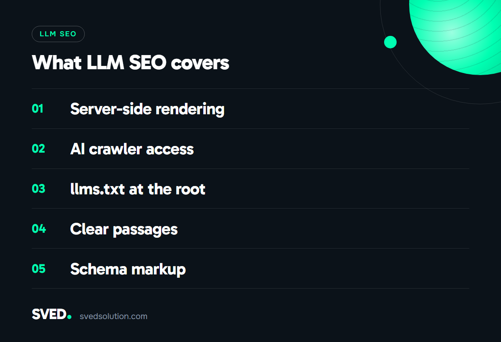

You can have the best content in your industry and still not appear in ChatGPT. Often the reason is that the AI model never got a clean version of your page that a machine can read. **LLM SEO** is the technical work that fixes this. It makes your site easy for large language models (LLMs, the AI models behind tools like ChatGPT) to read, split into passages and quote. The better-known methods are built on top of it, and searches for "llm seo" are rising as teams find the gap. Here is what it is and how to start.

## What is LLM SEO?

LLM SEO (Large Language Model SEO) means setting up your website's templates, markup, rendering and content so AI models can open a page, pull out a passage that makes sense on its own, and credit it to your brand. [Generative Engine Optimization](/generative-engine-optimization/) (GEO) works on your brand. [Answer Engine Optimization](/services/answer-engine-optimization/) (AEO) works on your answers. LLM SEO is the technical layer under both, and it is the focus of our [LLM SEO service](/services/llm-seo/).

Put simply: GEO and AEO decide *whether* an AI model wants to mention you. LLM SEO decides whether it *can*.

## Why LLM SEO matters

An AI model can only mention what it can find and read. Three common faults hide good content:

- **Client-side rendering.** If your content only appears after JavaScript runs in the visitor's browser, most AI crawlers see an empty shell.
- **Blocked crawlers.** Many sites block, by accident, the exact bots they want to be mentioned by.
- **No clear passages.** Walls of text with no clear sections give an AI model nothing clean to pull out.

Fix these and AI tools can find and read you. Leave them and no amount of GEO or content work will pay off. See [how to rank in ChatGPT](/insights/how-to-rank-in-chatgpt/) for how looking pages up and remembering brands work together.

## What LLM SEO covers

| Layer | What we do | Why it matters |
|---|---|---|
| Rendering | Server-side render key content | AI crawlers read the raw HTML, not JS |
| Crawler access | Set the rules for GPTBot, ClaudeBot, PerplexityBot, Google-Extended | Don't block the bots you want to mention you |
| llms.txt | Write it and keep it up to date at the domain root | Makes things clear for LLM crawlers |
| Chunking | Rebuild templates into clean passages | AI models take passages, not whole pages |
| Schema | Organization, Article, FAQPage | Context and identity signals that machines can read |

## How to start with LLM SEO

<figure style="margin:1.5rem 0"><figcaption style="font-size:.85rem;color:var(--text-faint);margin-top:.7rem;text-align:center">What LLM SEO covers.</figcaption></figure>

1. **Check what a bot can see.** Fetch your key pages the way a bot does and confirm the real content is in the raw HTML.
2. **Fix rendering.** Move the content that matters to pages built on the server or to static pages.
3. **Open the right crawlers.** Review robots.txt (the file that tells bots what they may read) and your AI crawler rules. Unblock the bots you want to be mentioned by.
4. **Add llms.txt and schema.** A clean `llms.txt` plus `Organization`, `Article` and `FAQPage` markup (code that labels what is on a page).
5. **Rebuild templates into clear passages.** Blocks that answer first, question headings, tables: content an AI model can lift cleanly. This is where LLM SEO meets [technical SEO](/services/technical-seo/).

## Frequently asked questions

**What is LLM SEO in simple terms?**
It is the technical work that makes your website easy for AI models to read and quote. It covers rendering, crawler access, structure and schema, so ChatGPT and others can mention you.

**How is LLM SEO different from GEO and AEO?**
LLM SEO is the technical base (can an AI model read you?). GEO works on the brand (does it trust and remember you?). AEO works on the answer (is your page the answer it quotes?). You need all three.

**Is llms.txt a ranking factor?**
Not yet. Few sites use it so far. But it is cheap to add and makes things clear for LLM crawlers, so we include it on every build.

**Should I block AI crawlers?**
Only if your income depends on people reading content on your own pages. If it depends on being found and recommended, blocking means you will never be mentioned.

**How long does LLM SEO take?**
Fixes that let AI tools read your pages can take effect within days of going live. Mentions then follow the usual timeline as GEO and content work build up: AI tools register who you are at 30 to 45 days, with first mentions around day 60.

## The bottom line

LLM SEO is the plumbing of AI visibility. If an AI model cannot read and quote your page, nothing else matters. Fix rendering, open the right crawlers, add llms.txt and schema, and rebuild templates so passages lift cleanly. Start with our [LLM SEO service](/services/llm-seo/) or run a free AI visibility check. It runs 20 checks on your live URL and needs no card.
